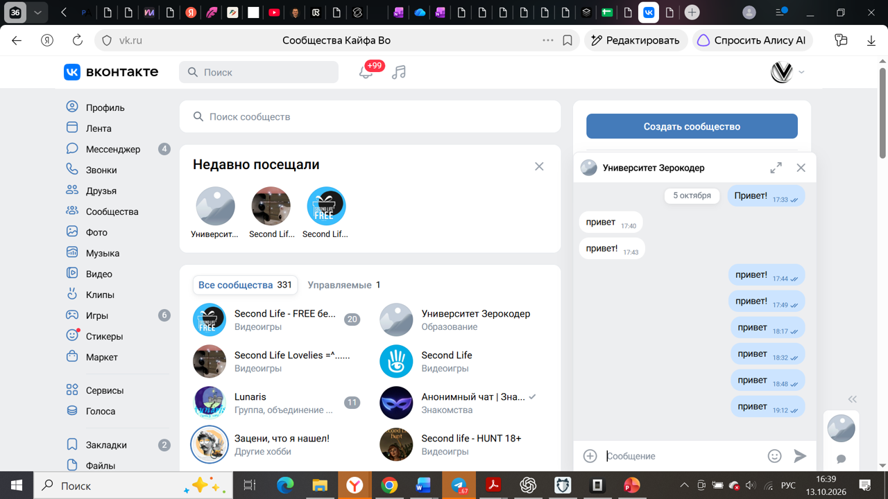
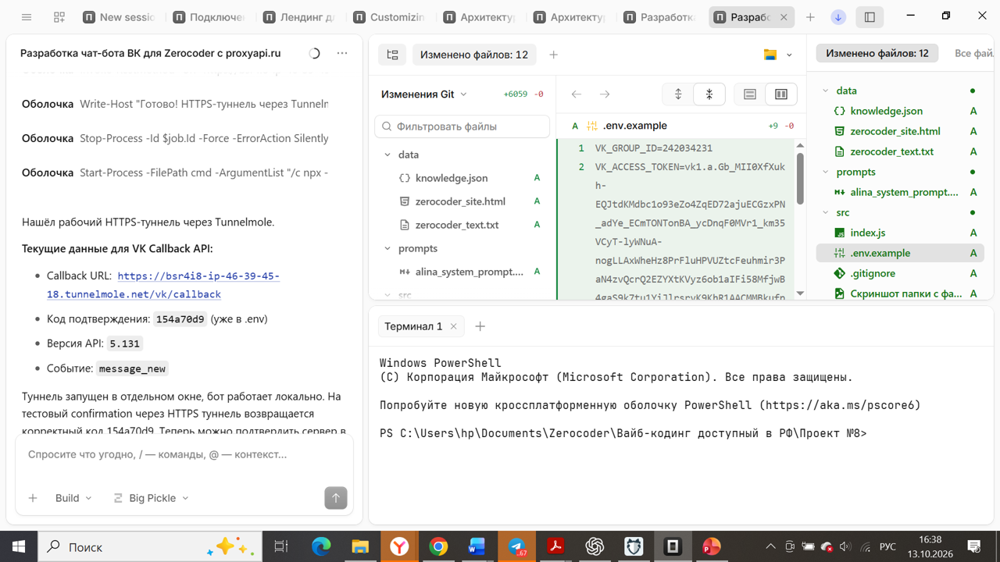
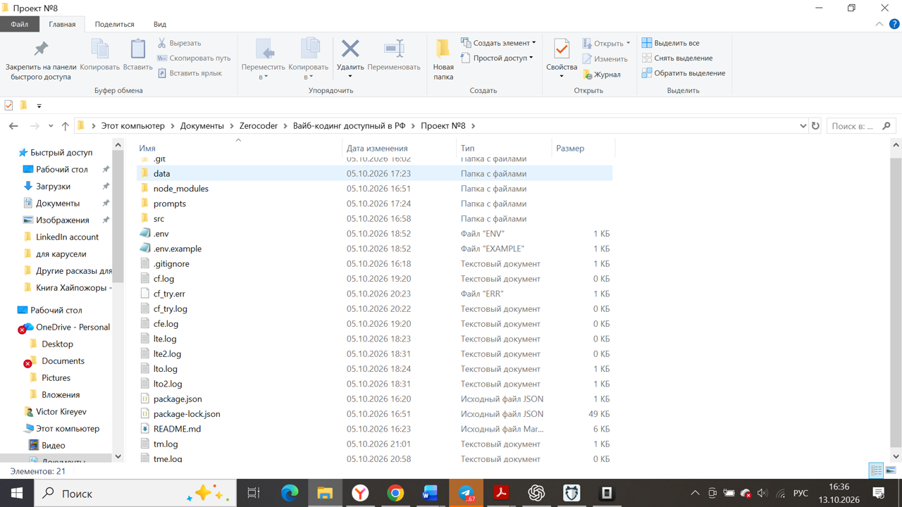

# Чат-бот «Алина» для сообщества Zerocoder во ВКонтакте

Чат-бот для сообщества ВКонтакте, который консультирует пользователей по курсам и образовательным направлениям онлайн-университета [Zerocoder](https://zerocoder.ru/). Бот отвечает на вопросы о программах обучения, мягко удерживает диалог в тематике университета и в нужный момент предлагает связаться с отделом продаж.

Проект создан в рамках курса «Вайб-кодинг» и демонстрирует практическую интеграцию LLM в реальный продукт: обработку webhook-событий VK Callback API, генерацию ответов через языковую модель и подключение базы знаний.



## Скриншоты

| Запуск проекта | Структура проекта |
|---|---|
|  |  |

## Возможности

- Приём и обработка webhook-событий ВКонтакте (`message_new`, `confirmation`) через VK Callback API
- Генерация ответов с помощью LLM через [proxyapi.ru](https://proxyapi.ru/)
- Системный промпт с жёсткой привязкой к тематике Zerocoder: бот не выходит за рамки своего назначения
- Подключаемая база знаний о курсах и программах (`data/knowledge.json`)
- Обработка ошибок и корректные ответы-заглушки при сбоях
- Все секреты передаются только через переменные окружения

## Технологии

- **Node.js** (>= 18) + **Express** — веб-сервер и приём webhook
- **axios** — запросы к VK API и proxyapi.ru
- **dotenv** — работа с переменными окружения
- **body-parser** — разбор JSON-событий
- **proxyapi.ru** — доступ к LLM (по умолчанию `openai/gpt-4.1-mini`)
- **VK Callback API** — приём сообщений сообщества

## Как это работает

1. Пользователь пишет сообщение в сообществе ВКонтакте.
2. ВКонтакте отправляет webhook-событие `message_new` на Callback URL бота.
3. Бот формирует запрос к proxyapi.ru, передавая системный промпт и базу знаний Zerocoder.
4. Полученный от LLM ответ отправляется пользователю через `messages.send`.

```
VK ──webhook──▶ Express (/vk/callback) ──▶ proxyapi.ru (LLM)
                                              │
VK ◀──messages.send───────────────────────────┘
```

## Структура проекта

```
.
├── src/
│   └── index.js                     # основной код бота (Express + VK + LLM)
├── prompts/
│   └── alina_system_prompt.md       # системный промпт Алины
├── data/
│   ├── knowledge.json               # база знаний о курсах Zerocoder
│   └── source/
│       └── zerocoder_text.txt       # исходные материалы для базы знаний
├── docs/
│   └── screenshots/                 # скриншоты для документации
├── .env.example                     # пример переменных окружения
├── .gitignore
├── package.json
└── README.md
```

## Требования

- Node.js >= 18.0.0
- Сообщество ВКонтакте с подключённым Callback API
- Аккаунт на [proxyapi.ru](https://proxyapi.ru/) с API-ключом

## Настройка окружения

1. Скопируйте `.env.example` в `.env`:

   ```bash
   cp .env.example .env
   ```

2. Заполните переменные своими значениями:

| Переменная | Назначение | Где получить |
|---|---|---|
| `VK_GROUP_ID` | ID сообщества ВКонтакте | В настройках сообщества ВК |
| `VK_ACCESS_TOKEN` | Ключ доступа группы | Управление сообществом → Работа с API → Ключи доступа (с правами на сообщения) |
| `VK_CONFIRMATION_CODE` | Код подтверждения для Callback API | Управление сообществом → Callback API → Подтверждение |
| `PROXYAPI_API_KEY` | API-ключ для proxyapi.ru | Личный кабинет [proxyapi.ru](https://proxyapi.ru/) |
| `PROXYAPI_BASE_URL` | Базовый URL proxyapi.ru | По умолчанию: `https://api.proxyapi.ru` |
| `AI_MODEL` | Модель LLM | По умолчанию: `openai/gpt-4.1-mini` |
| `BOT_USERNAME` | Имя бота | `Алина` |
| `KNOWLEDGE_BASE_PATH` | Путь к базе знаний | По умолчанию: `./data/knowledge.json` |
| `SYSTEM_PROMPT_PATH` | Путь к системному промпту | По умолчанию: `./prompts/alina_system_prompt.md` |
| `PORT` | Порт веб-сервера | По умолчанию: `3000` |

## Настройка Callback API ВКонтакте

1. В настройках сообщества: **Управление → Работа с API → Callback API**.
2. Укажите URL сервера (должен быть доступен по HTTPS — например, через ngrok или Cloudflare Tunnel).
3. Укажите версию API: `5.131`.
4. Добавьте тип события: `message_new`.
5. Получите `VK_CONFIRMATION_CODE` и впишите его в `.env`.
6. После запуска сервера подтвердите адрес.

## Установка и запуск

```bash
npm install
npm start      # запуск
npm run dev    # режим разработки (nodemon)
```

Сервер поднимется на порту `PORT` (по умолчанию `3000`). Проверить работоспособность можно запросом `GET /` — в ответ придёт `{ "status": "OK", "bot": "Алина (Zerocoder)" }`.

## Расширение базы знаний

Базу знаний можно пополнять в файле `data/knowledge.json`. Если нужной информации в базе нет, бот не придумывает её, а честно предлагает обратиться к менеджеру.

## Безопасность

- `.env` содержит секреты и **никогда** не должен попадать в Git (он уже в `.gitignore`)
- В репозитории присутствует только `.env.example` с названиями переменных без значений
- Все ключи и токены передаются исключительно через переменные окружения
- Бот не логирует и не хранит чувствительные данные

## Ограничения

- Бот отвечает **только** на вопросы, связанные с Zerocoder (курсы, программы, обучение)
- Вопросы вне тематики мягко переводятся обратно к обучению
- При отсутствии точного ответа бот не выдумывает информацию, а предлагает связаться с менеджером

## Лицензия

Проект распространяется под лицензией [MIT](LICENSE).
